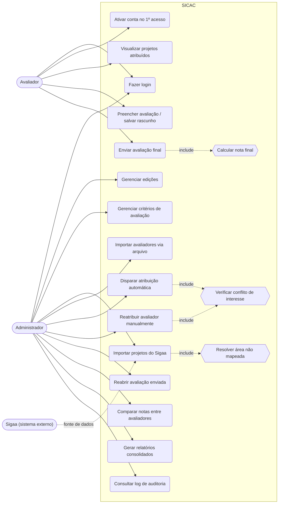

# Diagrama de Casos de Uso — SICAC

Mermaid não tem um tipo nativo de diagrama de casos de uso UML; a notação abaixo usa `flowchart` para aproximar a mesma leitura (atores à esquerda, casos de uso agrupados no sistema, relações `include` tracejadas).

## Notas sobre os casos de uso

- **UC1/UC2 (login e ativação)**: avaliador importado nasce sem senha; `UC2` só acontece uma vez, na primeira vez que ele acessa (ver [../docs/modelagem-dados.md](../docs/modelagem-dados.md), entidade `Usuario`).
- **UC3 (visualizar projetos atribuídos)**: nunca lista todos os projetos da edição — só os que têm `Atribuicao` ativa para aquele avaliador, e sem dados de autoria (avaliação às cegas).
- **UC4/UC5**: `UC4` pode ser repetido várias vezes (rascunho); `UC5` é definitivo e bloqueia edição posterior pelo avaliador.
- **UC10/UC11 → UC16**: tanto a atribuição automática quanto a reatribuição manual passam pela checagem de conflito de interesse (avaliador não pode ser orientador nem coautor do projeto).
- **UC8 → UC18**: quando a área do projeto vindo do Sigaa não bate com nenhum `AreaConhecimentoAlias` existente, o item de importação fica pendente até o admin resolver o mapeamento.
- **Sigaa** aparece como ator externo porque ele é quem dispara/fornece o dado de origem, mesmo que hoje a importação seja feita por upload manual do admin (ver seção de "Ingestão de projetos via Sigaa" em [../docs/plano-implementacao.md](../docs/plano-implementacao.md)).
