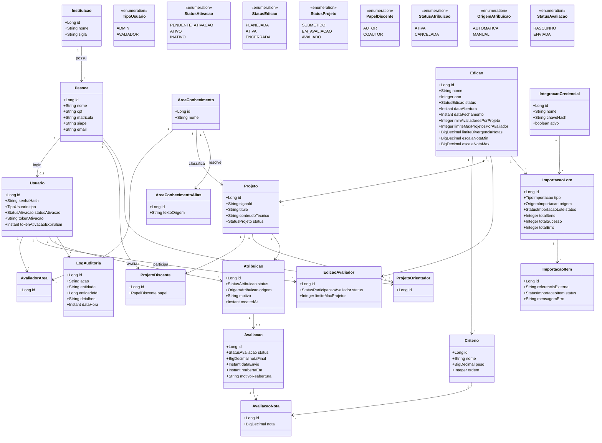

# Diagrama de Classes — Sistema de Avaliação de Projetos

Espelha as entidades JPA implementadas em `projeto_backend/src/main/java/com/avaliacao/sistema/entity/`. Atributos reduzidos aos campos relevantes para leitura (getters/setters do Lombok omitidos). Detalhe completo de cada campo: [../docs/modelagem-dados.md](../docs/modelagem-dados.md).

## Notas sobre o desenho

- **Pessoa vs. Usuario**: separadas de propósito — nem todo `Pessoa` (discente, orientador) tem `Usuario` (login). Só quem acessa o sistema (avaliador, admin) tem os dois. É essa separação que permite checar conflito de interesse comparando IDs de pessoa, mesmo para quem nunca logou.
- **AvaliadorArea vs. EdicaoAvaliador**: a especialidade do avaliador (`AvaliadorArea`) é um atributo permanente da pessoa; a participação numa edição específica (`EdicaoAvaliador`) é o que entra/sai a cada importação anual do arquivo de professores.
- **Atribuicao → Avaliacao (0..1)**: toda atribuição pode ou não ter uma avaliação associada ainda — vira `1` só depois que o avaliador começa a preencher (mesmo em rascunho).
- **Projeto.instituicao_id e ProjetoDiscente/ProjetoOrientador** não aparecem na visão do avaliador em nenhuma tela — esse corte é feito na camada de serviço/DTO, não neste diagrama de dados.
- **ProjetoDiscente/ProjetoOrientador são N:N sem limite superior**: um projeto tem exatamente um `AUTOR` (índice único parcial no banco) e pode ter vários `COAUTOR` e vários orientadores; uma mesma pessoa pode orientar vários projetos e, com `Usuario` próprio, avaliar projetos diferentes dos que orienta.
- **Edicao.min_avaliadores_por_projeto = 3** por padrão — todo projeto precisa de pelo menos 3 `Atribuicao` ATIVA. A nota do projeto (não modelada como coluna) é a média das `Avaliacao.nota_final` dessas atribuições.
