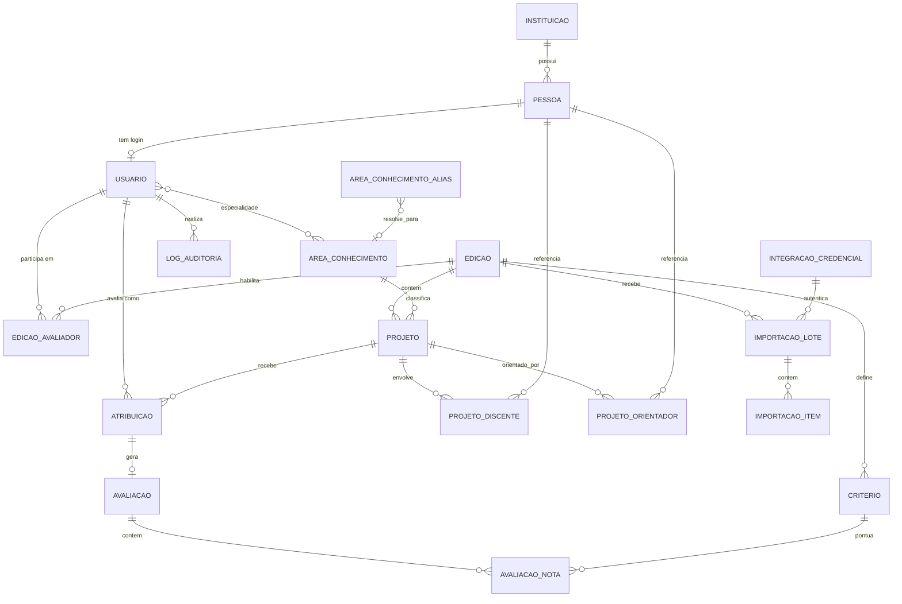

# Modelagem de Dados — Sistema de Avaliação de Projetos

Stack alvo: Java + Spring Boot (JPA/Hibernate + PostgreSQL, migrations via Flyway).

> Projetos não são cadastrados manualmente: chegam via **importação de um JSON exportado do Sigaa**. Avaliadores (professores) também não são cadastrados um a um: chegam via **importação de um arquivo** (lista de professores). O admin cadastra manualmente apenas o que não tem fonte externa (edições, critérios, áreas, mapeamentos, exceções).

## Diagrama entidade-relacionamento

## Entidades de domínio

### Instituicao
| campo | tipo | obs |
|---|---|---|
| id | PK | |
| nome | string | |
| sigla | string | |

### Pessoa
Identidade única de qualquer indivíduo referenciado no sistema (avaliador, orientador, discente, admin). Existir separada de `Usuario` é o que permite (a) checar conflito de interesse mesmo para gente sem login, e (b) casar registros repetidos vindos de importações diferentes (mesmo orientador aparece em vários projetos do Sigaa; mesmo professor pode reaparecer em arquivos de avaliadores de anos diferentes).

| campo | tipo | obs |
|---|---|---|
| id | PK | |
| nome | string | |
| cpf | string, unique, nullable | chave de deduplicação preferencial |
| matricula | string, nullable | discente — vem do Sigaa |
| siape | string, nullable | professor/servidor — vem do arquivo de avaliadores |
| email | string | |
| instituicao_id | FK Instituicao | dado cadastral, não usado em conflito de interesse |

Dedup na importação: casar por `cpf` se presente; senão por `matricula`/`siape` + `instituicao_id`; se nada bater, criar novo registro.

### Usuario
Credenciais de login. 1:1 com `Pessoa`. Só existe para quem acessa o sistema (Admin e Avaliador).

| campo | tipo | obs |
|---|---|---|
| id | PK | |
| pessoa_id | FK Pessoa, unique | |
| senha_hash | string, nullable | nulo até o professor definir senha própria |
| tipo | enum: ADMIN, AVALIADOR | |
| status_ativacao | enum: PENDENTE_ATIVACAO, ATIVO, INATIVO | regra 3 (admin pode desativar) |
| token_ativacao | string, nullable | gerado na importação, para o link de "definir senha no 1º acesso" |
| token_ativacao_expira_em | timestamp, nullable | |
| created_at / updated_at | timestamp | |

Fluxo de 1º acesso: import cria `Usuario` com `status_ativacao=PENDENTE_ATIVACAO`, `senha_hash=null` e um `token_ativacao` de uso único; e-mail (fora do escopo do banco — serviço de envio) leva o professor a uma tela de "definir senha", que grava `senha_hash` e muda status para `ATIVO`.

### AreaConhecimento
| campo | tipo | obs |
|---|---|---|
| id | PK | |
| nome | string | |
| area_pai_id | FK self, nullable | hierarquia opcional |

### AvaliadorArea (N:N)
Especialidade do avaliador — atributo da pessoa, não da edição (um professor não muda de área a cada ano). Usada no filtro de afinidade da atribuição.

| campo | tipo |
|---|---|
| avaliador_id | FK Usuario |
| area_id | FK AreaConhecimento |

### EdicaoAvaliador
Participação do avaliador **numa edição específica**. Existe porque o arquivo de professores é importado por edição (o pool de avaliadores pode mudar de ano para ano, mesmo que a `Pessoa`/`Usuario` já exista de uma edição anterior).

| campo | tipo | obs |
|---|---|---|
| id | PK | |
| edicao_id | FK Edicao | |
| avaliador_id | FK Usuario | |
| status | enum: ATIVO, INATIVO | admin pode inativar nesta edição sem afetar outras |
| limite_max_projetos | int, nullable | override do limite global da edição, se precisar |
| importado_de | FK ImportacaoLote, nullable | rastreabilidade |

Unique `(edicao_id, avaliador_id)`. O pool elegível para sorteio (regra 4) é sempre `EdicaoAvaliador` com `status=ATIVO` na edição ativa, filtrado por `AvaliadorArea`.

### Edicao
Só uma pode estar `ATIVA` por vez (validado em serviço).

| campo | tipo | obs |
|---|---|---|
| id | PK | |
| nome | string | ex: "Mostra Científica 2026" |
| ano | int | |
| status | enum: PLANEJADA, ATIVA, ENCERRADA | |
| data_abertura / data_fechamento | timestamp | prazo de avaliação |
| min_avaliadores_por_projeto | int, default 3 | todo projeto precisa de no mínimo 3 avaliadores atribuídos |
| limite_max_projetos_por_avaliador | int, nullable | default por edição; pode ser sobrescrito em `EdicaoAvaliador` |
| limite_divergencia_notas | decimal | threshold para sinalizar divergência |
| escala_nota_min / escala_nota_max | decimal | default 0/10 |

### Criterio
Configurável por edição.

| campo | tipo | obs |
|---|---|---|
| id | PK | |
| edicao_id | FK Edicao | |
| nome | string | ex: clareza, rigor metodológico, relevância |
| peso | decimal | |
| ordem | int | |

### AreaConhecimentoAlias
O texto/código de área que vem no JSON do Sigaa raramente bate 1:1 com a taxonomia interna (`AreaConhecimento`). Este alias resolve isso sem exigir que o Sigaa fale a mesma linguagem que o nosso sistema.

| campo | tipo | obs |
|---|---|---|
| id | PK | |
| texto_origem | string, unique | valor bruto recebido do Sigaa |
| area_id | FK AreaConhecimento, nullable | nulo até um admin mapear a primeira ocorrência |

Se `area_id` é nulo, o item de importação correspondente fica pendente (ver `ImportacaoItem`) até o admin mapear — não bloqueia o restante do lote.

### Projeto
| campo | tipo | obs |
|---|---|---|
| id | PK | |
| edicao_id | FK Edicao | |
| sigaa_id | string, unique por edição | identificador externo do Sigaa — permite upsert idempotente em reimportações |
| titulo | string | visível ao avaliador |
| conteudo_tecnico | text | visível ao avaliador |
| area_id | FK AreaConhecimento, nullable | resolvido via `AreaConhecimentoAlias` |
| instituicao_id | FK Instituicao | **oculto** ao avaliador |
| status | enum: SUBMETIDO, EM_AVALIACAO, AVALIADO | derivado |
| importado_de | FK ImportacaoLote | rastreabilidade |

Reimportação do mesmo `sigaa_id` dentro da mesma edição faz **upsert** (atualiza título/conteúdo/área), nunca duplica o projeto.

### ProjetoDiscente / ProjetoOrientador (N:N)
Ligam `Projeto` a `Pessoa` com papel. Nunca expostos ao avaliador — usados só pelo admin e pelo motor de conflito de interesse.

| campo | tipo |
|---|---|
| projeto_id | FK Projeto |
| pessoa_id | FK Pessoa |
| papel (só em ProjetoDiscente) | enum: AUTOR, COAUTOR |

- Um projeto tem **exatamente um** `AUTOR` e pode ter quantos `COAUTOR` forem necessários — garantido por índice único parcial (`uk_projeto_discente_um_autor`, `WHERE papel = 'AUTOR'`); "pelo menos um autor" fica a cargo da validação de serviço no momento da importação.
- Um projeto pode ter **mais de um** `ProjetoOrientador` — sem limite, é N:N puro.
- Uma mesma `Pessoa` pode orientar vários projetos (`ProjetoOrientador` não é exclusivo por pessoa) e, se também tiver `Usuario` como avaliador, pode avaliar projetos **diferentes** dos que orienta — o conflito de interesse (regra 4.2) só bloqueia a combinação orientador↔projeto específico, não a pessoa como um todo.

### Atribuicao
Vínculo avaliador↔projeto. Unicidade `(projeto_id, avaliador_id)` para status ATIVA. Um mesmo avaliador pode ter `Atribuicao` ativa em vários projetos ao mesmo tempo — o único teto é o `limite_max_projetos_por_avaliador` (configurável por edição, ver `EdicaoAvaliador`), não um limite fixo de "um projeto por avaliador".

| campo | tipo | obs |
|---|---|---|
| id | PK | |
| projeto_id | FK Projeto | |
| avaliador_id | FK Usuario | |
| status | enum: ATIVA, CANCELADA | reatribuição cancela a antiga e cria nova |
| origem | enum: AUTOMATICA, MANUAL | |
| motivo | text, nullable | obrigatório quando origem = MANUAL |
| criado_por | FK Usuario, nullable | admin quando manual; null quando automática |
| created_at | timestamp | |

### Avaliacao
1:1 com `Atribuicao`.

| campo | tipo | obs |
|---|---|---|
| id | PK | |
| atribuicao_id | FK Atribuicao, unique | |
| status | enum: RASCUNHO, ENVIADA | |
| nota_final | decimal, nullable | calculada pelo sistema, não editável |
| data_envio | timestamp, nullable | |
| reaberta_em | timestamp, nullable | |
| reaberta_por | FK Usuario, nullable | só admin |
| motivo_reabertura | text, nullable | obrigatório quando reaberta |

`Avaliacao.nota_final` é a nota **do parecer individual** de um avaliador (média ponderada dos critérios). A **nota do projeto** é outra coisa — é a média aritmética simples das `Avaliacao.nota_final` de todos os avaliadores atribuídos que já enviaram (regra: mínimo 3 por projeto). Não existe coluna `Projeto.nota_final`: é calculada em serviço a partir de `Atribuicao (status=ATIVA) → Avaliacao (status=ENVIADA)`, do mesmo jeito que o status "avaliado" do projeto (regra 7.1) — se fosse persistida, uma reabertura de avaliação (regra 6.4) deixaria o valor salvo desatualizado até alguém lembrar de recalcular.

### AvaliacaoNota
| campo | tipo | obs |
|---|---|---|
| id | PK | |
| avaliacao_id | FK Avaliacao | |
| criterio_id | FK Criterio | |
| nota | decimal | validada contra escala da edição |

Unique `(avaliacao_id, criterio_id)`.

### LogAuditoria
| campo | tipo |
|---|---|
| id | PK |
| usuario_id | FK Usuario, nullable (ação automática do sistema) |
| acao | string/enum |
| entidade | string |
| entidade_id | bigint |
| detalhes | json/text |
| data_hora | timestamp |

## Entidades de integração/importação

### IntegracaoCredencial
Credencial de serviço (API key) para chamadas máquina-a-máquina — cobre tanto "Sigaa chama nosso webhook" quanto qualquer outro processo automatizado. Upload manual pelo admin usa a sessão dele normalmente e não precisa disso.

| campo | tipo | obs |
|---|---|---|
| id | PK | |
| nome | string | ex: "Sigaa - Mostra Científica" |
| chave_hash | string | nunca armazenar em texto puro |
| ativo | boolean | |
| criado_em / ultimo_uso_em | timestamp | |

### ImportacaoLote
Registro de cada importação — seja o JSON de projetos do Sigaa, seja o arquivo de avaliadores. Mantém o payload bruto para reprocessamento/auditoria.

| campo | tipo | obs |
|---|---|---|
| id | PK | |
| tipo | enum: PROJETOS_SIGAA, AVALIADORES_ARQUIVO | |
| edicao_id | FK Edicao | |
| origem | enum: WEBHOOK, UPLOAD_MANUAL | |
| payload_bruto_ref | string | caminho/chave do arquivo original guardado (object storage), não o conteúdo inline |
| status | enum: RECEBIDO, PROCESSANDO, CONCLUIDO, CONCLUIDO_COM_ERROS, FALHOU | |
| total_itens / total_sucesso / total_erro | int | |
| iniciado_em / concluido_em | timestamp | |
| usuario_id | FK Usuario, nullable | quem fez upload manual |
| credencial_id | FK IntegracaoCredencial, nullable | se via webhook |

### ImportacaoItem
Resultado por registro dentro do lote — essencial para o admin ver *quais* linhas/projetos falharam e por quê, sem precisar que o lote inteiro seja tudo-ou-nada.

| campo | tipo | obs |
|---|---|---|
| id | PK | |
| lote_id | FK ImportacaoLote | |
| referencia_externa | string | id do projeto no Sigaa, ou linha/identificador no arquivo |
| status | enum: SUCESSO, ERRO, IGNORADO_DUPLICADO, PENDENTE_MAPEAMENTO | `PENDENTE_MAPEAMENTO` = área sem alias resolvido |
| mensagem_erro | text, nullable | |
| entidade_resultante_id | bigint, nullable | id do `Projeto`/`Usuario` criado ou atualizado |

## Mapeamento regra → schema

- **Avaliador só vê projetos atribuídos** (regra 1): query sempre filtrada por `Atribuicao.avaliador_id = usuário logado`.
- **Avaliação cega** (regra 5): projeção/DTO separada por perfil — endpoint do avaliador nunca faz join com `ProjetoDiscente`/`ProjetoOrientador`/`Instituicao`.
- **Conflito de interesse** (regra 4.2, 8): avaliador excluído do pool se `Pessoa.id` dele aparecer em `ProjetoOrientador` (é o orientador) **ou** em `ProjetoDiscente` (é coautor) do projeto. Checagem de mesma instituição foi descartada por decisão do usuário — simplifica o motor e evita excluir avaliadores válidos só por estarem na mesma instituição do projeto. Decisão de exclusão do pool vai para `LogAuditoria`.
- **Edição única ativa** (regra 2): validação de serviço antes de marcar `Edicao` como ATIVA.
- **Sem reaproveitamento entre edições** (regra 2): `Avaliacao` só existe pendurada em `Atribuicao → Projeto → Edicao`; sem mecanismo de cópia.
- **Nota final calculada** (regra 6.3): recalculada no servidor a partir de `AvaliacaoNota × Criterio.peso`; nunca aceita como input direto.
- **Projeto "avaliado"** (regra 7.1): status derivado — todas as `Atribuicao` ATIVAS do projeto têm `Avaliacao.status = ENVIADA`.
- **Mínimo de 3 avaliadores por projeto**: `Edicao.min_avaliadores_por_projeto` (default 3) é o N usado no sorteio (Fase 5 do plano); projeto com menos de 3 `Atribuicao` ATIVA fica sinalizado como atribuição incompleta.
- **Nota do projeto = média das avaliações**: calculada em serviço como a média aritmética de `Avaliacao.nota_final` de todas as `Atribuicao` ATIVA com `Avaliacao.status = ENVIADA` do projeto — não confundir com `Avaliacao.nota_final`, que é a nota de um parecer individual.
- **Um autor, N coautores, N orientadores**: `uk_projeto_discente_um_autor` garante no máximo um `AUTOR` por projeto no banco; `COAUTOR` e `ProjetoOrientador` são N:N sem limite superior.
- **Avaliador avalia vários projetos / orientador avalia projeto alheio**: nenhuma constraint limita `Atribuicao` a um projeto por avaliador; o conflito de interesse (regra 4.2) compara `Pessoa.id` **por projeto específico**, então a mesma pessoa pode orientar o Projeto A e avaliar o Projeto B sem problema.
- **Importação idempotente do Sigaa**: upsert por `Projeto.sigaa_id` dentro da edição — reenviar o mesmo JSON não duplica.
- **Área não reconhecida não trava o lote**: fica `ImportacaoItem.status = PENDENTE_MAPEAMENTO`; depois que o admin resolve o `AreaConhecimentoAlias`, o item pode ser reprocessado isoladamente.
- **Pool de sorteio depende da edição** (regra 4.1): filtro sempre passa por `EdicaoAvaliador (edicao_id, status=ATIVO)`, não só por `AvaliadorArea` (que é global à pessoa).
- **1º acesso do avaliador importado**: `Usuario.status_ativacao=PENDENTE_ATIVACAO` + `token_ativacao` até ele definir senha — nunca chega com senha pronta.
